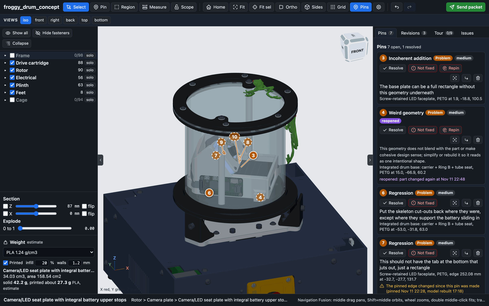
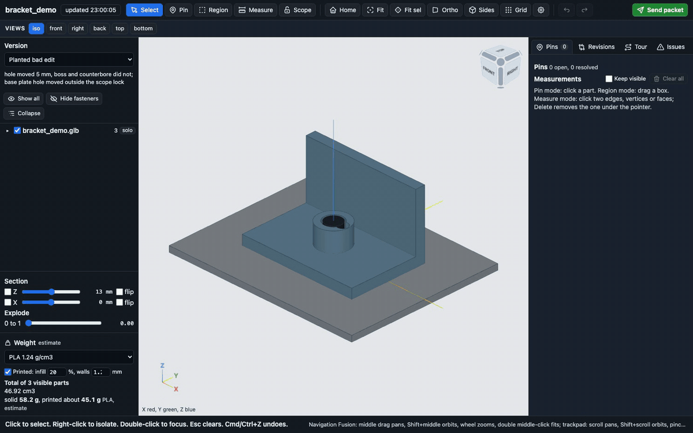
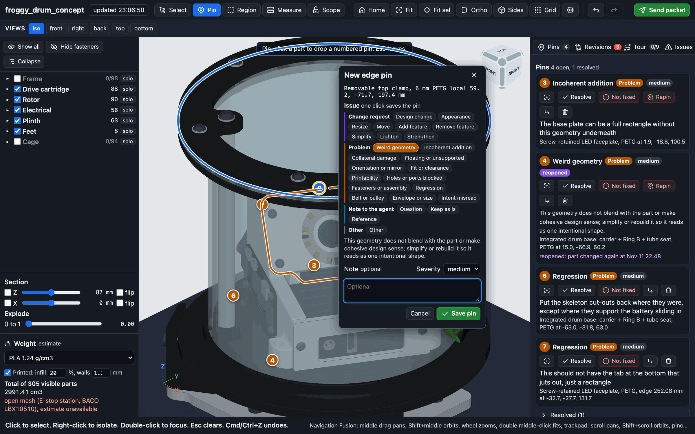
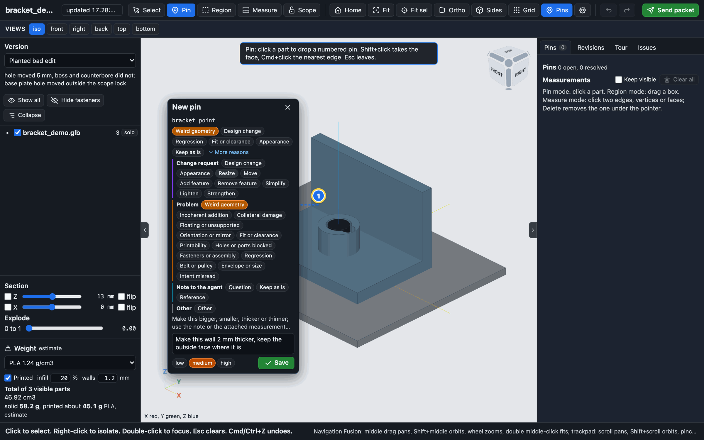
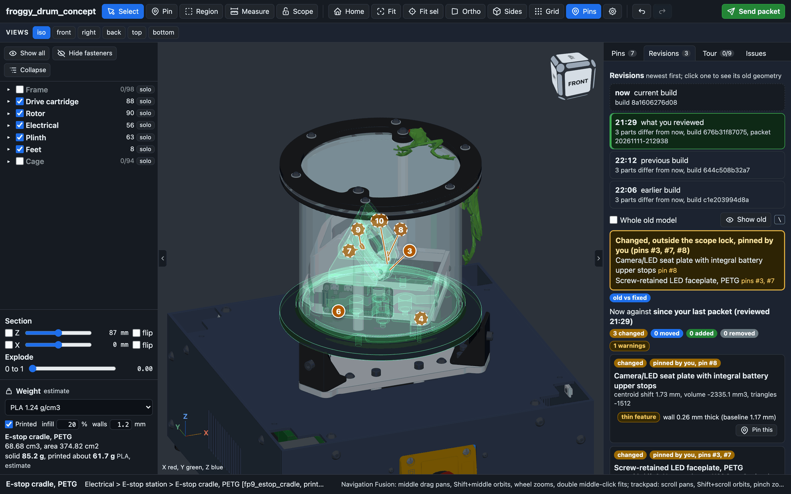
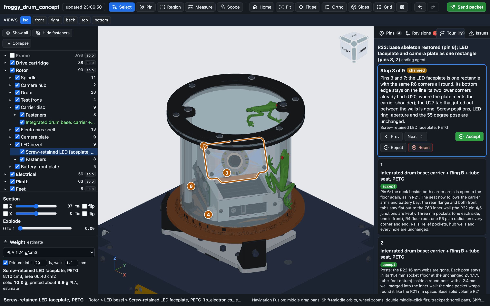
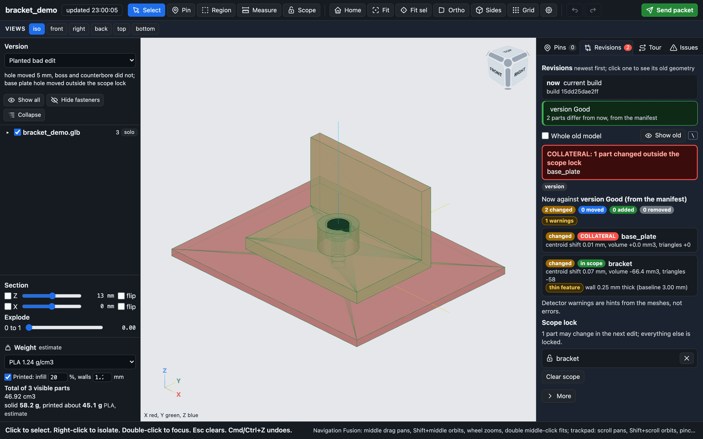
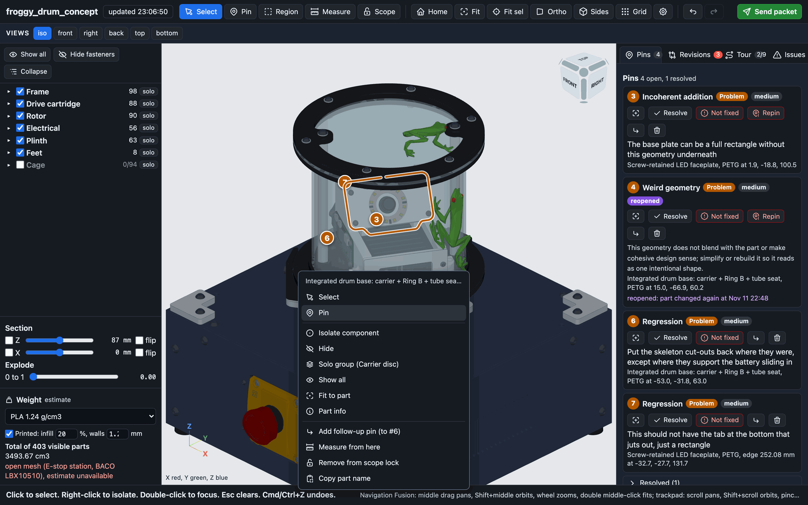
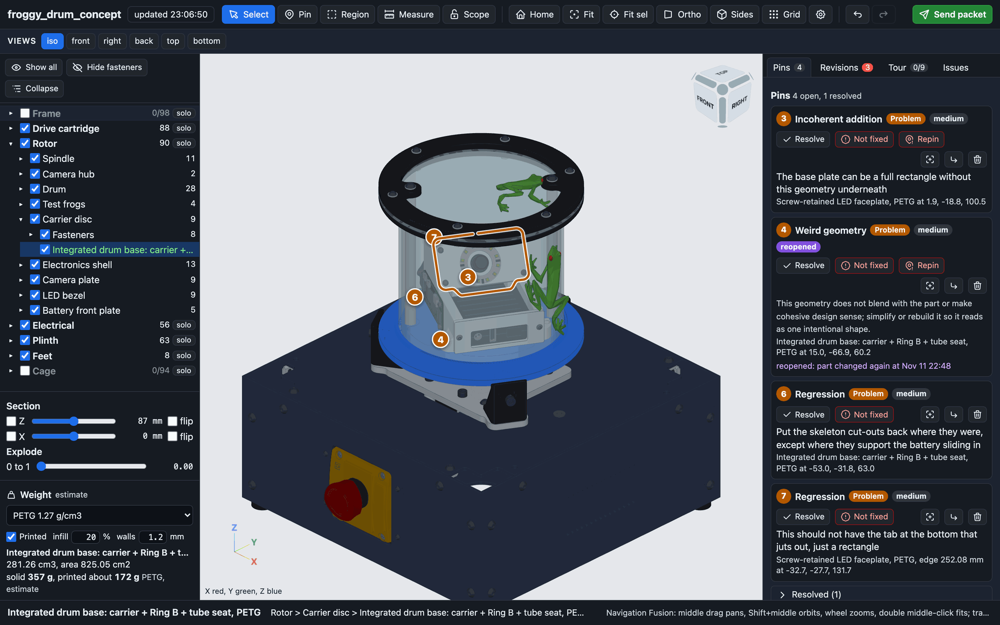

# aad

<p align="center"></p>

**agent aided design.** A local review workspace for CAD that coding agents write.

Coding agents such as Claude Code and Codex can write CAD as code (build123d, CadQuery, OpenSCAD). Getting a
first part out of them is the easy bit. The hours go into review rounds: describing which part or which edge is
wrong, the agent fixing one thing and breaking another, and never being sure what changed. aad makes that loop
exact. You click a part, a point or an edge and pin it with an issue class, lock the parts the next edit may
touch, and send a packet the agent reads with one command. When the model is rebuilt you compare it with the
version you reviewed, part by part, with anything that changed outside the lock flagged as collateral, and the
agent's change tour to accept or reject stop by stop.

<p align="center"></p>

It is a small Python package with one runtime dependency (numpy) and a browser page with every library
vendored. It reads any GLB (and STL or PLY), runs on 127.0.0.1 and makes no network calls.

## What it does

- **Pins on the exact thing.** Click a part, a point on a face, a feature edge, or drag a box over several
  parts. Each pin stores the GLB node name, the point and normal in the part's own coordinates (or the whole
  edge polyline), the camera, and an issue class. A note is optional: the class is a complete instruction.
- **Classes in four groups.** Change requests (resize, move, add or remove a feature, simplify, strengthen and
  more), problems (weird geometry, collateral damage, fit, printability, regression and more), notes to the
  agent (a question to answer without changing anything, a keep pin that locks a spot, a reference to match)
  and other. Markers take the group colour.
- **A scope lock.** Mark the parts the next edit may change. Everything else is locked, and the agent is told
  so. A keep pin locks one spot even inside the scope: any geometry that changes within 5 mm of it is flagged.
- **Packets.** Send packet writes `packet.json` plus a screenshot with the pins numbered, and copies a short
  prompt for the agent. The agent runs `aad review --json` and gets every pin with its part, point and reason.
- **Revisions against what you reviewed.** Every build is kept. After a rebuild the viewer compares the new
  model with the build your last packet was sent against, however many builds came in between, and lists the
  parts that changed. Click any earlier revision to see its geometry over the current model as a green
  hologram, or hold `\` to flick between old and new. Any part that changed outside the scope lock is listed
  first as collateral.
- **Mesh checks.** The comparison warns about new loose shells, sliver triangles, walls that got thinner than
  0.5 mm, a triangle count that doubled or halved, and parts that no longer touch anything.
- **A change tour.** The agent writes `tour.json`: an ordered list of what it changed and why. The viewer flies
  to each stop and you accept, reject or repin it.
- **Escalation.** Not fixed moves a pin to the top with an attempt count, and the agent is told not to repeat
  the same approach. Repin moves a pin that was missed to the spot that is wrong now, keeping its id and its
  earlier spots in its history. Follow-up pins hang under the pin they follow. A resolved pin reopens if its
  part changes again.
- **A viewer you can live in.** Fusion style navigation with free orbit, a view cube with roll and step
  arrows, a part tree, section planes, explode, Measure that snaps to vertices, edges and planes (two edges of
  a wall read its thickness, wherever you click along them), a weight estimate for printed or solid parts,
  live reload on every rebuild, and one undo history over everything.

## Screenshots

<table>
<tr>
<td align="center"><br><sub>Pinning a feature edge. The card floats beside the pin and one click on a class saves it.</sub></td>
<td align="center"><br><sub>The pin card: change requests, problems, notes to the agent. The note is optional.</sub></td>
</tr>
<tr>
<td align="center"><br><sub>Since your last packet: two parts changed outside the scope lock, their old shape as a green hologram.</sub></td>
<td align="center"><br><sub>The agent's change tour. Each stop flies to its parts; accept, reject or repin.</sub></td>
</tr>
<tr>
<td align="center"><br><sub>The bracket demo: the base plate changed outside the scope lock, and the bracket kept a 0.25 mm wall.</sub></td>
<td align="center"><br><sub>Right-click a part to pin it, isolate it, measure from it or change the scope lock.</sub></td>
</tr>
<tr>
<td align="center"><br><sub>Weight estimate for the selected part: solid and printed with infill and walls.</sub></td>
<td align="center"></td>
</tr>
</table>

## Quick start

Python 3.10 or newer.

```
git clone https://github.com/partypancake8/aad.git
cd aad
python -m venv .venv && . .venv/bin/activate
pip install -e .
aad demo
```

`aad demo` copies the bracket demo to a temp folder and opens it. The demo is a printed bracket bolted to a
base plate, with a planted bad edit: the agent was asked to move the hole 5 mm, moved the hole but not the boss
around it (leaving a 0.25 mm wall), and also moved the hole in the base plate, which was outside the scope lock.
Open the Revisions tab and click the Good version to see both caught.

On your own model:

```
aad view out/my_part.glb --project .
```

The model reloads in place every time the file changes, so leave the viewer open while the agent works. Point
it at a directory to load every `.glb`, `.stl` and `.ply` in it, or at a `versions.json` to switch between named
versions. Name your parts in code: the comparison, the pins and the scope lock all follow GLB node names.

## How an agent uses it

The agent never opens the browser. It reads the same state from the command line:

```
aad review --json          # open pins in review order, scope lock, keep pins, baseline, latest diff, camera
aad review diff            # the rebuilt model against the build you last reviewed, collateral first
aad review tour-template   # an empty tour.json to fill in and save as .cadreview/tour.json
```

[`AGENTS.md`](AGENTS.md) has a block to paste into your agent's instructions. In short: read the review at the
start of every CAD turn; a pin with no note is complete; only parts in the scope lock may change, and a pin on
a locked part is reported back, never moved onto another part; not fixed and repinned pins first, and never the
same approach twice; question pins are answered, not acted on; keep pins are locked; for a regression pin,
restore the revision where it was right without undoing later requests; after the build run the diff and
explain any collateral; write a tour; never resolve or delete the reviewer's pins; never loosen a check to make
a build pass.

### Slash command

`aad agent install` installs a skill named `aad` for Claude Code and Codex. It orients a fresh agent on aad:
what it is, the loop, the vocabulary, every command, how to read a pin from the JSON and the ten rules. It
does not start any work; after loading it the agent waits for you to ask.

```
aad agent install                  # both tools, user level (~/.claude/skills/aad/, ~/.codex/skills/aad/)
aad agent install --project .      # this project only (.claude/skills/aad/, .agents/skills/aad/)
```

- Claude Code: `/aad`. Claude also loads it on its own when you mention pins or paste a packet prompt.
- Codex: `$aad`, or pick `aad` from `/skills`.

The installed file ends with an empty "Local notes" section for machine-specific notes (your launchers, your
ports). Reinstalling keeps it, and never replaces a different file without `--force`.

## Review files

Review state lives in the CAD project, in `.cadreview/`, as plain JSON that both sides read and write:

    .cadreview/
      pins.json        every pin and its status: open, resolved, reopened or not_fixed, with its history
      scope.json       the parts that may change in the next edit
      tour.json        the agent's change tour and your accept or reject per stop
      diff.json        the latest comparison
      baselines/       earlier builds (the newest 10, "Stored builds to keep" in the Revisions tab changes it)
                       and every build a recent packet was sent against
      packets/<time>/  packet.json and view.png from each Send packet

Every file carries `"schema": "cadreview/1"` and is validated against the JSON Schemas in
[`aad/review/schemas/`](aad/review/schemas) before it is written. [`docs/reference.md`](docs/reference.md) has
the full format, every command and the optional viewer inputs (a part tree, named cameras, build status,
colours for STL files).

The review files record absolute local paths: the project directory, the model files a packet or baseline was
made from, and the packet's own location in its agent prompt. They also hold copies of your models. Add the
whole `.cadreview/` to `.gitignore`. If you do want to commit pins or the scope lock, commit only those files
and read them first for paths you would rather not publish.

## Security

`aad view` listens on 127.0.0.1 only and has no login, so any program or user on the same machine that can
reach the port can use it. What it does guard against is other web pages open in your browser: it answers
only requests whose Host is `127.0.0.1`, `localhost` or `[::1]` on its own port (which stops DNS rebinding),
and it accepts a write (POST, PUT or DELETE) only as `Content-Type: application/json` with no foreign
`Origin` and no cross-site `Sec-Fetch-Site`, so another site cannot forge pins, a scope lock or a packet that
an agent would then read. It never sends CORS headers, and every response carries
`X-Content-Type-Options: nosniff` and `Cross-Origin-Resource-Policy: same-origin`.

## Navigation

Two button presets in Options (the gear button). The footer always names the active one.

| Gesture | Fusion (default) | Classic |
|---|---|---|
| Orbit | Shift + middle drag; trackpad: Shift + two-finger scroll | left drag, Shift + middle drag |
| Pan | middle drag; trackpad: two-finger scroll | right or middle drag |
| Zoom to cursor | wheel; trackpad: pinch | wheel, two-finger scroll, pinch |
| Fit | double middle-click | Fit button |
| Left button | the active tool only (select, pin, region, measure, scope) | orbit on drag, tool on click |

Orbit is free by default: the drag turns the model about a screen axis, through and past the top and bottom,
with no locked up direction. Options switches it to constrained (turntable, Z stays up). The orbit pivots about
the centre of what is shown, or of the selection when there is one; Options can pivot about the point under the
cursor instead.

The view cube snaps to a face, edge or corner on click and orbits live on drag. With the pointer on it, Home
sits at its top left, two roll arrows at its top right turn the view 90 degrees, and a triangle on each side
steps to the adjacent face. Each move is one undo step.

Drag the divider between the left panel and the view (200 to 520 px) or between the view and the right panel
(300 to 720 px) to resize them; the view keeps at least 360 px. A focused divider moves 16 px per arrow key, a
double-click resets it, and the divider under the part tree sets the tree's height. The chevron on a divider
collapses that panel to a slim rail. Sizes are remembered in the browser (`aad-pane-*`).

Edge pins made on an earlier build are matched against the current edges of their part. When the edge is gone,
the pin's card says so, the selected pin draws the old edge thin and dashed as "edge as pinned", and
`aad review` reports `edge_changed`. Pin markers that would overlap fan out with leaders to their points, and a
pin behind other geometry keeps its number readable with a dimmed fill and a dashed ring (Options: Dim pins
behind geometry).

| Key | |
|---|---|
| V, P, G, M, S | Select, Pin, Region, Measure, Scope |
| H | show or hide the pins in the view (markers, pinned edges, repin trails, attached measurements) |
| Shift+H, F | Home, fit selection |
| `\` (hold) | show the selected old revision solid in place of the current model |
| Delete | remove the measurement under the pointer |
| `,` and `.` | collapse or bring back the left and right panel (`[` and `]` stay with Move) |
| Esc | cancel the current step, then leave the tool |
| Cmd/Ctrl+Z, Shift+Cmd/Ctrl+Z | undo, redo (camera moves, visibility, pins, scope, measurements and tour decisions) |

## Tests

```
pip install -e ".[test]"
python -m pytest -q
```

The browser checks drive the real page headless with Playwright on a temp copy of the demo:

```
npm install playwright && npx playwright install chromium
python tests/browser/run.py
```

They run locally only; CI runs the Python tests and `aad view --check`.

## Roadmap

- Kernel face and edge identity, so a pin survives a rebuild that changes the mesh but not the face.
- Part history with a scrub bar and bisect, to find the build where a regression came in.
- An MCP server, so an agent can read pins and post a tour without a shell.
- A benchmark of agent CAD edits: requests, the reviewed model, and how much collateral each edit caused.

## License

MIT, see [`LICENSE`](LICENSE). The vendored libraries in `aad/viewer/vendor/` are MIT as well; their
versions, sources and checksums are in [`vendor/LICENSES.txt`](aad/viewer/vendor/LICENSES.txt).
